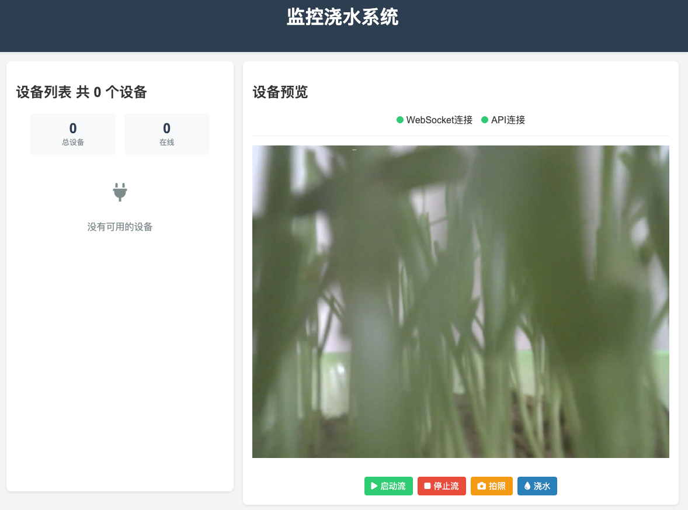

# Sinica · 远程监控浇水系统

> 基于 **ESP32-CAM + Django Channels** 的物联网远程监控与自动浇水系统：在浏览器中实时查看植物画面、监测土壤湿度，并远程控制浇水。

[](https://www.python.org/)
[](https://www.djangoproject.com/)
[](https://channels.readthedocs.io/)
[](https://www.espressif.com/)



---

## 目录

- [功能特性](#功能特性)
- [系统架构](#系统架构)
- [目录结构](#目录结构)
- [快速开始](#快速开始)
- [配置说明](#配置说明)
- [接口文档](#接口文档)
- [硬件接线](#硬件接线)
- [常见问题](#常见问题)
- [生产环境部署注意事项](#生产环境部署注意事项)
- [Roadmap](#roadmap)
- [许可证](#许可证)

---

## 功能特性

| 功能 | 说明 |
| :--- | :--- |
| 📹 实时视频流 | ESP32-CAM 以 JPEG 帧通过 WebSocket 推流，浏览器端逐帧渲染（默认采样间隔 33 ms，约 30 FPS） |
| 📷 远程拍照 | 丢弃 2～3 帧缓存后抓取最新画面，保证画面实时性 |
| 🌱 土壤湿度监测 | 同时上报模拟量（AO）与数字量（DO，干/湿阈值判断） |
| 💧 远程浇水 | 通过继电器控制水泵，非阻塞计时，到时自动关闭 |
| 🔌 设备管理 | 多设备接入与在线状态识别（按 `device_id` 区分） |
| ♻️ 摄像头按需释放 | 摄像头首次使用时初始化，闲置 10 分钟自动释放，降低功耗与发热 |
| 🔐 页面访问令牌 | 监控页面需携带 token 才能访问 |

## 系统架构

```
┌──────────────┐   WebSocket (二进制 JPEG 帧 / JSON 上报)    ┌─────────────────────────┐
│  ESP32-CAM    │ ───────────────────────────────────────▶ │  Django + Channels     │
│  · 摄像头     │                                          │  ┌───────────────────┐  │
│  · 继电器     │ ◀───── 控制指令 (JSON: start_stream,      │  │ Esp32CamConsumer  │  │
│  · 土壤传感器 │         stop_stream, take_photo,          │  │  /ws/esp32-cam/   │  │
└──────────────┘         start_water, soil_data)            │  └───────────────────┘  │
                                                            │           │ group_send│
                                                            │  ┌────────▼──────────┐  │
┌──────────────┐   WebSocket (帧 / 湿度数据广播)            │  │ DeviceConsumer    │  │
│  浏览器页面   │ ◀──────────────────────────────────────── │  │  /ws/device/      │  │
│  监控 + 控制  │ ────── HTTP API (设备列表 / 控制命令) ───▶ │  └───────────────────┘  │
└──────────────┘                                          └─────────────────────────┘
```

- **设备上行**：ESP32-CAM 连接 `/ws/esp32-cam/?device_id=<id>`，二进制消息为视频帧，文本消息为 JSON 数据（如土壤湿度）。
- **内部广播**：`Esp32CamConsumer` 将帧与传感器数据通过 Channel Layer 转发到 `monitor` 组。
- **页面下行**：浏览器连接 `/ws/device/` 加入 `monitor` 组，实时接收帧与数据。
- **控制下行**：页面通过 HTTP API 调用后端，后端按 `device_id` 找到对应设备的 channel，再下发 JSON 指令。

## 目录结构

```
sinica/
├── manage.py
├── requirements.txt            # pip 依赖
├── Pipfile / Pipfile.lock      # pipenv 依赖
├── sinica/                     # Django 项目配置
│   ├── settings.py             # 含 SECRET_TOKEN、Channel Layer 等自定义配置
│   ├── urls.py
│   └── asgi.py                 # ASGI 入口（HTTP + WebSocket 路由）
├── fatcat/                     # 核心应用
│   ├── consumers.py            # Esp32CamConsumer（设备）/ DeviceConsumer（页面）
│   ├── views.py                # HTTP API（设备列表、控制命令）
│   ├── routing.py              # WebSocket 路由
│   ├── urls.py                 # HTTP 路由
│   └── templates/fatcat/
│       └── index.html          # 单页监控前端
├── esp32-cam/
│   ├── ESP32-CAM.ino           # 固件源码（Arduino）
│   └── camera_pins.h           # AI-Thinker 摄像头引脚定义
└── demo/
    └── img.png                 # 界面截图
```

## 快速开始

### 环境要求

- Python 3.9+
- ESP32-CAM 开发板（本项目使用 **AI-Thinker** 型号）
- 继电器模块、土壤湿度传感器、水泵（可选，无硬件时也可只跑后端）

### 1. 安装并启动后端

```bash
git clone https://github.com/Activity00/sinica.git
cd sinica

# 方式一：pipenv（推荐，与 Pipfile 一致）
pipenv install --dev
pipenv run pip install daphne

# 方式二：pip
python -m venv .venv && source .venv/bin/activate
pip install -r requirements.txt
pip install daphne

# 数据库初始化（当前模型为空，仅创建默认表）
python manage.py migrate

# 启动 ASGI 服务（Channels 必须使用 ASGI 服务器，不能用 runserver）
daphne -b 0.0.0.0 -p 8989 sinica.asgi:application
```

### 2. 访问监控页面

页面入口受令牌保护，**必须在 URL 中携带 `?token=`**，否则返回 `403 Invalid Token`：

```
http://<服务器IP>:8989/?token=<SECRET_TOKEN>
```

`SECRET_TOKEN` 默认值定义在 `sinica/settings.py` 中，部署前请修改（见[配置说明](#配置说明)）。

### 3. 烧录 ESP32-CAM 固件

1. Arduino IDE 中安装 **ESP32 开发板支持包**（含 `esp_camera`）。
2. 安装库：
   - `WebSockets`（Markus Sattler / links2004）
   - `ArduinoJson` **6.x**（固件使用 `StaticJsonDocument`，不兼容 7.x 的 `JsonDocument` 写法）
   - `base64`（用于摄像头帧编码）
3. 修改 `esp32-cam/ESP32-CAM.ino` 顶部的配置（WiFi、服务器地址、`device_id`）。
4. 开发板选择 `AI Thinker ESP32-CAM`，上传固件；上传时如遇失败，将 GPIO0 接地后重新上电再上传，完成后断开 GPIO0。

设备连接成功后，页面左侧设备列表会出现在线设备，日志中可见 `ESP32Cam connected: device_id=...`。

## 配置说明

### 后端（`sinica/settings.py`）

| 配置项 | 默认值 | 说明 |
| :--- | :--- | :--- |
| `SECRET_TOKEN` | 见文件内注释 | 监控页面访问令牌，通过 `?token=` 传入 |
| `SECRET_KEY` | Django 生成值 | 生产环境务必改为环境变量读取 |
| `DEBUG` | `True` | 生产环境改为 `False` |
| `ALLOWED_HOSTS` | `[]` | 部署时填入服务器域名 / IP |
| `CHANNEL_LAYERS` | `InMemoryChannelLayer` | 仅支持单进程；多进程部署需切换为 Redis（见下文） |

### 固件（`esp32-cam/ESP32-CAM.ino`）

| 常量 | 说明 |
| :--- | :--- |
| `ssid` / `password` | WiFi 名称与密码（**仓库中为示例值，请替换，切勿提交真实凭据**） |
| `ws_server` / `ws_port` | 后端服务器地址与端口（需与 daphne 监听端口一致） |
| `ws_path` | 设备 WebSocket 路径，默认 `/ws/esp32-cam/` |
| `device_id` | 设备唯一标识，多设备需各不相同 |
| `RELAY_PIN` | 继电器引脚，默认 `14` |
| `SOIL_SENSOR_AO` / `SOIL_SENSOR_DO` | 土壤传感器模拟/数字引脚，默认 `12` / `13` |
| `streamInterval` | 推流间隔（ms），默认 `33` |
| `CAMERA_IDLE_TIMEOUT_MS` | 摄像头闲置释放时间，默认 10 分钟 |

## 接口文档

### HTTP API

所有控制类接口均为 `POST`，请求体为 JSON，返回 `{"status": "ok" | "error", "message": "..."}`。

| 方法 | 路径 | 请求体 | 说明 |
| :--- | :--- | :--- | :--- |
| `GET` | `/api/devices/` | — | 获取在线设备列表 |
| `POST` | `/api/start_stream/` | `{"device_id": "..."}` | 启动视频流 |
| `POST` | `/api/stop_stream/` | `{"device_id": "..."}` | 停止视频流 |
| `POST` | `/api/take_photo/` | `{"device_id": "..."}` | 拍摄并回传一张照片 |
| `POST` | `/api/start_water/` | `{"device_id": "..."}` | 启动浇水（Web 端默认 15 秒） |
| `POST` | `/api/get_soil/` | `{"device_id": "..."}` | 立即读取一次土壤湿度 |

示例：

```bash
curl -X POST http://<服务器IP>:8989/api/start_water/ \
     -H "Content-Type: application/json" \
     -d '{"device_id": "esp32-cam-001"}'
```

```json
{ "status": "ok", "message": "浇水命令已发送到 esp32-cam-001" }
```

设备不在线时返回 `{"status": "error", "message": "设备 xxx 不在线"}`。

### WebSocket

| 端点 | 连接方 | 说明 |
| :--- | :--- | :--- |
| `/ws/device/` | 浏览器 | 加入 `monitor` 组，接收广播数据 |
| `/ws/esp32-cam/?device_id=<id>` | ESP32-CAM | 缺少 `device_id` 时拒绝连接 |

**后端 → 浏览器**消息格式：

```json
{ "type": "frame", "device_id": "esp32-cam-001", "frame": "<base64 JPEG>" }
{ "type": "soil",  "device_id": "esp32-cam-001", "soil_data": { "analog": 1830, "digital": true } }
```

**后端 → 设备**指令格式：

```json
{ "action": "start_stream" }
{ "action": "stop_stream" }
{ "action": "take_photo" }
{ "action": "start_water", "ts": 15 }
{ "action": "soil_data" }
```

`start_water` 的 `ts` 为浇水秒数，设备端有效范围 `1–60`，缺省为 10 秒。

**设备 → 后端**上行数据：

```
二进制消息 → 视为摄像头 JPEG 帧
文本消息   → {"device_id": "esp32-cam-001", "type": "soil", "data": {"analog": 1830, "digital": true}}
```

## 硬件接线

| 模块 | 引脚 | ESP32-CAM GPIO |
| :--- | :--- | :--- |
| 继电器（控制水泵） | IN | GPIO 14 |
| 土壤湿度传感器 | AO（模拟量） | GPIO 12 |
| 土壤湿度传感器 | DO（数字量） | GPIO 13 |
| 电源 | 5V / GND | 5V / GND（建议独立供电，避免掉压重启） |

> ⚠️ 继电器驱动的水泵请使用独立电源，并与主控共地；高压侧请做好绝缘与防护。

## 常见问题

**Q：访问页面提示 `403 Invalid Token`？**
A：页面入口需要 `?token=<SECRET_TOKEN>`，请对照 `sinica/settings.py` 中的值。

**Q：页面没有画面 / 设备列表为空？**
A：检查设备是否已连接（后端日志应有 `ESP32Cam connected`）、`ws_server` 是否正确指向服务器 IP、防火墙是否放行 8989 端口。`/api/devices/` 只返回已连接的设备。

**Q：启动视频流卡顿或延迟大？**
A：降低 `config.frame_size`（如 `FRAMESIZE_QVGA`）、调大 `config.jpeg_quality`（数值越大画质越低、编码越快），或增大 `streamInterval`。

**Q：Arduino 编译报 JSON 相关错误？**
A：请使用 ArduinoJson **6.x**；7.x 已弃用 `StaticJsonDocument`。

**Q：上传固件失败？**
A：将 GPIO0 接地后重新上电进入下载模式，上传完成后断开 GPIO0 并复位。

**Q：`daphne: command not found`？**
A：Channels 4.x 不再自带 daphne，需单独 `pip install daphne`（已在快速开始中说明）。

**Q：多进程 / 多实例部署后设备与页面连不到一起？**
A：`InMemoryChannelLayer` 只能在单进程内转发消息，需改用 Redis Channel Layer。

## 生产环境部署注意事项

当前配置为开发/实验用途，正式部署前建议：

1. **改用 Redis 作为 Channel Layer**，支持多进程与横向扩展：
   ```python
   # settings.py
   CHANNEL_LAYERS = {
       "default": {
           "BACKEND": "channels_redis.core.RedisChannelLayer",
           "CONFIG": {"hosts": [("127.0.0.1", 6379)]},
       },
   }
   ```
   并安装 `channels-redis`。
2. 关闭 `DEBUG`，配置 `ALLOWED_HOSTS`，将 `SECRET_KEY`、`SECRET_TOKEN`、WiFi 凭据改为**环境变量**读取，不要把真实凭据提交到仓库。
3. 前置 Nginx 反向代理并启用 **WSS/TLS**，注意为 WebSocket 配置 `Upgrade` / `Connection` 头。
4. 为 ESP32-CAM 配置独立电源，并考虑为设备连接增加鉴权（当前 `device_id` 即可接入）。
5. 添加 `.gitignore`，排除 `db.sqlite3`、`__pycache__/`、`.venv/` 等产物。

## Roadmap

- [ ] 设备接入鉴权（令牌 / 双向认证）
- [ ] 土壤湿度历史曲线与浇水记录落库
- [ ] 湿度低于阈值自动浇水
- [ ] 多设备同屏监控
- [ ] 配置项改为环境变量 / `.env`

## 许可证

本项目尚未声明开源许可证。如需允许他人使用、修改与分发，建议补充 `LICENSE` 文件（如 [MIT License](https://choosealicense.com/licenses/mit/)）。
